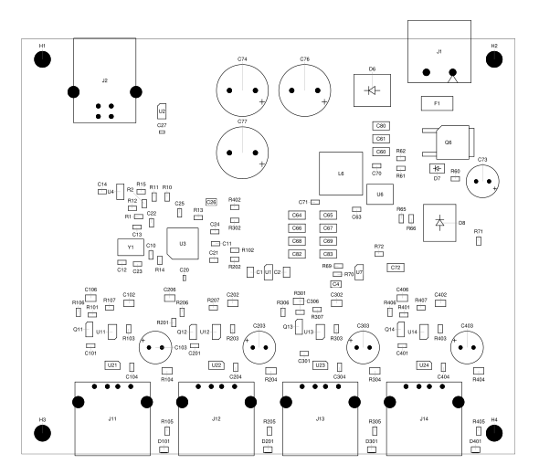

# Sai Kham Hein

I build embedded systems, tools for my workbench, and robots I’m learning to make walk.

[Website & project notes](https://saikhamhein.github.io/)

## On my workbench

### [BenchSwitch USB DUT Hub](https://github.com/saikhamhein/benchswitch-usb-dut-hub)

A four-port USB 2.0 hub I’m building to power-cycle development boards from the host computer, so a test script or software agent can restart a board without someone unplugging it.

Actual PCB assembly drawing. Prototype; hardware testing is pending.

[KiCad sources & build files](https://github.com/saikhamhein/benchswitch-usb-dut-hub) · [Project notes](https://saikhamhein.github.io/posts/benchswitch-usb-dut-hub/)

### [agent-skills](https://github.com/saikhamhein/agent-skills)

The workflows I use for coding delegation, electronics, CAD and animation. Includes bounded DeepSeek delegation for Codex and Claude Code, with review and verification kept with the lead agent. Experimental and shared as is.

### [StrideForge](https://saikhamhein.github.io/posts/strideforge/)

An ongoing quadruped project: leg design, CAD and learned walking in MuJoCo. I’m keeping notes on what works and what still needs fixing. The physical robot is still to be built.

---

Small useful builds, focused checks, and iteration.
